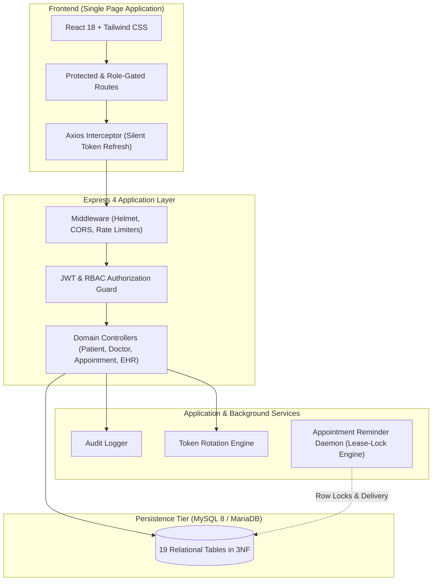

<div align="center">

# 🏥 Meridian — Hospital Management System

**An Enterprise-Grade, Production-Ready Clinical & Hospital Operations Platform**

[](https://react.dev/)
[](https://nodejs.org/)
[](https://www.mysql.com/)
[](https://tailwindcss.com/)
[](https://playwright.dev/)
[](#-enterprise-grade-security--compliance)

<p align="center">
  <a href="#-key-engineering-highlights">Key Highlights</a> •
  <a href="#-system-architecture">Architecture</a> •
  <a href="#-role-based-access-matrix">RBAC Matrix</a> •
  <a href="#-quick-start">Quick Start</a> •
  <a href="#-database-design--er-overview">Database</a> •
  <a href="#-api-reference-overview">API Reference</a> •
  <a href="#-demo-credentials">Demo Accounts</a> •
  <a href="#-test-suite">Testing</a>
</p>

---

</div>

## 📌 Executive Summary

**Meridian** is a full-stack, enterprise-hardened Hospital Management System engineered with strict clinical domain modeling. Unlike generic CRUD tutorials, Meridian implements **true mathematical slot computation**, **dynamic doctor availability scheduling**, **atomic conflict detection**, **concurrency-safe appointment lifecycles**, **multi-item structured prescriptions**, and **comprehensive immutable audit logs**.

Engineered on a **3NF-normalized 19-table relational database**, Meridian guarantees strict ACID transactions, role-based boundary isolation, and cryptographically verified session security.

---

## ⚡ Key Engineering Highlights

```
 ┌──────────────────────────────────────────────────────────────────────────────────┐
 │                                                                                  │
 │  ✦ Real Slot Computation: Subtracts active bookings from weekly doctor shifts    │
 │  ✦ Token Family Rotation: Detects & invalidates compromised refresh token reuse  │
 │  ✦ Token Versioning: Instant session revocation upon password/security change    │
 │  ✦ Concurrency Locks: InnoDB row-level locking (SELECT FOR UPDATE) on bookings   │
 │  ✦ Background Worker: Autonomous appointment reminder daemon with claim leases  │
 │  ✦ Audit Compliance: Immutable audit trails tracking every sensitive mutation    │
 │  ✦ 3NF Normalization: 19 tables with declarative foreign-key cascading integrity │
 │                                                                                  │
 └──────────────────────────────────────────────────────────────────────────────────┘
```

### 1. 🗓️ Dynamic Availability & Mathematical Slot Engine
- Calculates consultation windows in real time by intersecting a doctor's weekly recurring shift schedule with date-specific constraints.
- Prevents double-booking via atomic SQL locks during concurrent checkout attempts.
- Enforces instant slot recalculation upon appointment cancellations or reschedules.

### 2. 🛡️ Enterprise-Grade Security & Compliance
- **Dual-Token Architecture**: Short-lived JWT access tokens paired with rotating refresh tokens stored in hashed state.
- **Token Family Invalidation**: Reuse detection triggers automatic revocation of all issued descendant tokens in that family.
- **Global Token Versions**: Changing a password or administrative kill-switch immediately invalidates active sessions across all devices.
- **Security Hardened**: Protected with Helmet headers, parameterized Sequelize ORM queries, granular rate limiters (API + Auth routes), and file upload MIME verification.

### 3. ⏱️ Resilient Background Reminder Engine
- Dedicated background worker (`server/src/workers/appointmentReminderWorker.js`) with lease-based claiming.
- Safe atomic delivery transactions prevent duplicate notifications.
- Integrated MySQL advisory locks protect against split-brain execution across multiple worker nodes.

### 4. 🩺 Clinical Realism & Electronic Health Records (EHR)
- Structured diagnoses, symptomatic observations, vitals recording, and follow-up timelines.
- Multi-medication structured prescriptions linked directly to encounters.
- Secure medical attachment vault with strict file-type checks and size thresholds.

---

## 🏗️ System Architecture



---

## 👥 Role-Based Access Matrix

Meridian enforces authorization guards at **both** UI route boundaries and every single backend REST controller endpoint.

| Domain / Resource | Admin | Doctor | Receptionist | Patient |
|:---|:---:|:---:|:---:|:---:|
| **Analytics & Operational Dashboards** | Full System | Doctor Assigned | Front Desk Metrics | Personal Health Hub |
| **User & Staff Account Provisioning** | ✍️ Read / Write | 🚫 None | 🚫 None | 🚫 None |
| **Doctor Schedule Configuration** | ✍️ Manage | ✍️ Self Only | 👁️ View Only | 👁️ View Slots |
| **Patient Directory & Profiles** | ✍️ Full Access | 👁️ Assigned / Care | ✍️ Register / Update | 👁️ Self Only |
| **Appointment Booking & Rescheduling** | ✍️ Full Access | ✍️ Self Schedule | ✍️ Full Access | ✍️ Self Booking |
| **Clinical Encounter & EHR Entry** | 👁️ Audit View | ✍️ Author & Sign | 🚫 None | 👁️ Self History |
| **Prescription Creation** | 🚫 None | ✍️ Author & Issue | 🚫 None | 👁️ View / Download |
| **System Security & Audit Logs** | 👁️ Full Audit | 🚫 None | 🚫 None | 🚫 None |

---

## 🗄️ Database Design & ER Overview

The relational schema strictly satisfies **Third Normal Form (3NF)** with 19 dedicated tables, indexed foreign keys, and unique constraint guarantees.

```
       [ ROLES ] ───< [ USERS ] ──────┬───< [ REFRESH_TOKENS ]
                          │           ├───< [ PASSWORD_RESET_TOKENS ]
                          │           ├───< [ NOTIFICATIONS ]
                          │           └───< [ AUDIT_LOGS ]
                          │
          ┌───────────────┴───────────────┐
          ▼                               ▼
     [ DOCTORS ]                     [ PATIENTS ]
          │                               │ ├──< [ PATIENT_EMERGENCY_CONTACTS ]
          ├──< [ DOCTOR_SCHEDULES ]       │ └──< [ PATIENT_INSURANCE ]
          │                               │
          └───┬───────────────────────────┴───┐
              │                               │
              ▼                               ▼
       [ APPOINTMENTS ] <──────────────> [ MEDICAL_RECORDS ]
              │                               │
              ├──< [ APPOINTMENT_REMINDERS ]  ├──< [ PRESCRIPTIONS ] ──< [ PRESCRIPTION_ITEMS ]
              └──< [ PAYMENTS ]               └──< [ MEDICAL_ATTACHMENTS ]
```

> 📖 **Deep Dive:** Comprehensive database schema documentation, index definitions, and architectural decisions are detailed in [`docs/DATABASE.md`](docs/DATABASE.md).

---

## 🚀 Quick Start

### 📋 Prerequisites
- **Node.js**: `v18.0.0` or higher
- **npm**: `v9.0.0` or higher
- **MySQL Server**: `8.0+` or **MariaDB** `10.6+`

---

### Step 1: Clone & Configure Database

```bash
# Clone the repository
git clone https://github.com/srisnigdha-08/Hospital-Management-System.git
cd Hospital-Management-System

# Initialize schema and seed data
mysql -u root -p < database/schema.sql
mysql -u root -p < database/seed.sql
```

---

### Step 2: Configure & Start Backend Server

```bash
cd server

# Copy environment template
cp .env.example .env

# Configure your database credentials and JWT keys in server/.env
# DB_HOST=localhost
# DB_USER=your_db_user
# DB_PASSWORD=your_db_password
# DB_NAME=hospital_management

# Install dependencies and start development server
npm install
npm run dev
```
> Server runs on `http://localhost:5000`

---

### Step 3: Configure & Start Frontend Client

```bash
# Open a new terminal
cd client

# Copy environment template
cp .env.example .env

# Install dependencies and launch Vite dev server
npm install
npm run dev
```
> Client runs on `http://localhost:5173`

---

### Step 4 (Optional): Start Reminder Background Daemon

To process scheduled appointment reminders autonomously:
```bash
cd server
npm run worker:reminders
```

---

## 🔑 Demo Credentials

All seed accounts are pre-populated with standard testing data.

> 🔒 **Universal Demo Password:** `Passw0rd!`

| Role | Email Address | Access Level & Scope |
|:---|:---|:---|
| **System Administrator** | `admin@hms.test` | Complete platform management, staff directory, audit trails |
| **Cardiology Specialist** | `r.verma@hms.test` | Doctor dashboard, schedule manager, medical encounters, EHR |
| **Pediatrics Specialist** | `s.iyer@hms.test` | Doctor dashboard, pediatric care history, prescriptions |
| **Front Desk Receptionist** | `n.fernandes@hms.test` | Patient admissions, counter bookings, scheduling desk |
| **Registered Patient A** | `karan.shah@hms.test` | Patient portal, self appointment booking, personal records |
| **Registered Patient B** | `priya.nair@hms.test` | Patient portal, personal prescriptions, upcoming appointments |

---

## 🌐 API Reference Overview

Meridian exposes a version-ready REST API with consistent envelope responses (`ApiResponse` / `ApiError`).

| Module | Method | Endpoint | Authorization | Description |
|:---|:---:|:---|:---:|:---|
| **Auth** | `POST` | `/api/v1/auth/login` | Public | Authenticates credentials; issues access + refresh pair |
| **Auth** | `POST` | `/api/v1/auth/refresh-token` | Public | Exchanges refresh token with rotation validation |
| **Auth** | `POST` | `/api/v1/auth/logout` | Authenticated | Revokes current refresh token |
| **Patients** | `GET` | `/api/v1/patients` | Staff | Paginated patient list with query filters |
| **Patients** | `POST` | `/api/v1/patients` | Admin, Reception | Registers new patient with emergency contacts |
| **Doctors** | `GET` | `/api/v1/doctors` | All Roles | Lists active doctors with department metadata |
| **Doctors** | `GET` | `/api/v1/doctors/:id/slots` | All Roles | Calculates dynamic available appointment slots |
| **Appointments**| `POST` | `/api/v1/appointments` | All Roles | Books appointment slot with double-booking check |
| **Appointments**| `PATCH`| `/api/v1/appointments/:id/status`| Staff | Transitions appointment lifecycle state |
| **Medical** | `POST` | `/api/v1/medical-records` | Doctor | Encounters, diagnoses, structured Rx & attachments |
| **Dashboard** | `GET` | `/api/v1/dashboard/stats` | Authenticated | Aggregated metrics scoped to authenticated role |
| **Audit** | `GET` | `/api/v1/audit-logs` | Admin | Filterable platform-wide immutable activity logs |

> 📚 Complete request/response schemas, query parameters, and error codes are detailed in [`docs/API.md`](docs/API.md).

---

## 🧪 Test Suite

Meridian includes comprehensive test coverage spanning unit testing, concurrency validation, and end-to-end browser workflows:

```bash
# Run server unit & regression tests
cd server
npm test

# Run configuration and security unit tests
npm run test:config

# Run end-to-end browser tests (Playwright)
cd client
npm run test:browser
```

---

## 📁 Repository Structure

```
hospital-management-system/
├── client/                          # React 18 Single Page Application
│   ├── src/
│   │   ├── api/                     # Axios instance & centralized API calls
│   │   ├── components/              # Reusable UI primitives, layouts & charts
│   │   ├── context/                 # AuthContext & global state providers
│   │   ├── hooks/                   # Custom business hooks (useAuth, useDebounce)
│   │   ├── pages/                   # Module pages (admin, appointments, patients, etc.)
│   │   ├── routes/                  # Protected & role-guarded routing tree
│   │   └── utils/                   # Calendar helpers, formatters & constants
│   ├── e2e/                         # Playwright end-to-end browser test suites
│   └── vite.config.js               # Vite bundler configuration
│
├── server/                          # Node.js + Express REST API
│   ├── src/
│   │   ├── config/                  # Sequelize ORM, security & environment config
│   │   ├── controllers/             # Request handlers & HTTP coordination
│   │   ├── middleware/              # Authentication, RBAC, error & rate-limit guards
│   │   ├── migrations/              # Database schema migrations
│   │   ├── models/                  # 19 Sequelize ORM models & relational associations
│   │   ├── routes/                  # REST API route declarations
│   │   ├── services/                # Business logic, token rotation & reminder engine
│   │   ├── utils/                   # Standardized ApiResponse, ApiError & logger
│   │   ├── validators/              # express-validator schemas
│   │   └── workers/                 # Background appointment reminder daemon
│   └── test/                        # Concurrency, hardening & unit test suites
│
├── database/                        # Database Assets
│   ├── schema.sql                   # 19-table DDL with full foreign keys & indexes
│   ├── seed.sql                     # Verified sample dataset for testing
│   └── test-bootstrap.sql           # Isolated testing target bootstrap
│
└── docs/                            # Architectural & Operational Documentation
    ├── API.md                       # Complete API endpoint specification
    ├── DATABASE.md                  # Comprehensive schema & normalization rationale
    ├── DEPLOYMENT.md                # Cloud production deployment guidelines
    ├── ENVIRONMENT.md               # Environment variables specification
    └── REMINDER_MYSQL_INTEGRATION_EVIDENCE.md # Integration review package
```

---

## 🔒 Security Best Practices

- 🚫 **Zero Hardcoded Secrets**: Secrets and database credentials are strictly injected via runtime environment variables.
- 🚫 **Never Commit `.env`**: Environment configuration files are explicitly blocked by `.gitignore`.
- 🛡️ **Role Tampering Prevention**: Identity and permissions are resolved exclusively from verified server-side JWT claims.
- 🛡️ **SQL Injection Immunity**: All database interaction passes through parameterized Sequelize queries.
- 🛡️ **XSS & CSRF Defense**: Helmet security headers configured, CORS restricted to designated client origins.

---

## 🤝 Contributing

Contributions, issues, and feature requests are welcome!

1. Fork the Project
2. Create your Feature Branch (`git checkout -b feature/clinical-enhancement`)
3. Commit your Changes (`git commit -m "feat: implement enhanced lab report workflow"`)
4. Push to the Branch (`git push origin feature/clinical-enhancement`)
5. Open a Pull Request

---

## 📄 License

This project is licensed under the [MIT License](LICENSE).

---

<div align="center">
  <sub>Engineered with precision for modern healthcare infrastructure.</sub>
</div>
