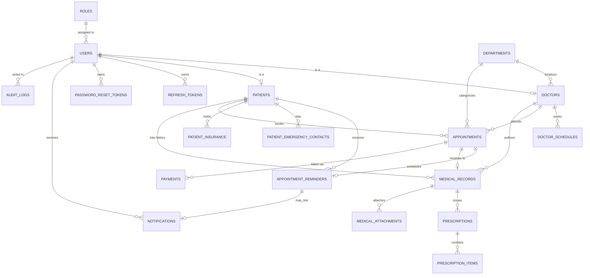

# Database Design

MySQL 8 / MariaDB 10.6+. Full DDL is in [`../database/schema.sql`](../database/schema.sql),
sample data in [`../database/seed.sql`](../database/seed.sql).

## ER Diagram



19 tables in total. `roles`, `refresh_tokens`, `password_reset_tokens`,
`appointment_reminders`, `payments`, `notifications` and `audit_logs` are omitted from some of the
narrative below for brevity but are fully defined in `schema.sql`.

`appointment_reminders` stores one reminder lifecycle row per appointment.
Its columns ending in `_utc` represent absolute UTC instants stored in MySQL
`DATETIME(3)` columns; the Sequelize connection timezone is pinned to UTC. A
notification may reference at most one reminder, and its scheduled-start
snapshot remains available if the reminder row is later removed. Appointment
lifecycle transactions enroll eligible reminders and replace or invalidate
pending rows as appointments change. No worker polls these rows automatically,
and the API does not create or deliver reminder notifications. The
dependency-injected worker library supports candidate discovery, claim leases,
retry bookkeeping, eligibility checks, and a separate atomic in-app delivery
operation. That operation locks the appointment before its reminder, then
creates the notification and marks the reminder delivered in one managed
transaction. The unique notification-to-reminder constraint prevents a second
notification row for that reminder. If the transaction result is uncertain,
the service re-reads authoritative reminder and notification state and does not
blindly insert again. This guarantees at most one linked in-app notification
row when the database transaction and unique constraint behave as expected; it
does not guarantee a user sees or reads it. A separate worker entry point is
available through `npm run worker:reminders`, but it is never started by API
startup. Its read-only readiness path authenticates and checks the complete
schema preflight without running migrations. Reminders remain operationally
inactive unless an operator explicitly launches that separate process after
deployment readiness review.

Successful delivery consumes one of the five lifetime attempts. Failed
attempts use the existing 1, 2, 4, and 8 minute retry schedule, subject to the
appointment-start cutoff. Claim leases are configured by an injected caller
and must be positive integers no greater than five minutes. Due, lease, and
appointment timestamps are compared as absolute instants. The service uses an
injected process clock and checks the appointment-start boundary before its
transaction returns. That does not guarantee the notification commits or
becomes visible before appointment start; a database commit can finish after
the final in-transaction check. A conservative cutoff margin is a possible
future policy, not a current hard delivery guarantee. Synchronized time across
multiple worker hosts has not been established and must be confirmed before
multi-host execution.

When processing cannot determine whether delivery committed, the worker retains
the claim. It waits for the remaining lease; recovery then counts the failed
attempt and schedules backoff from recovery time. A later attempt can thus wait
for the remaining lease plus the retry delay, or be skipped at the appointment-
start cutoff. This is an intentional duplicate-prevention tradeoff.

The worker's bounded shutdown wait does not abort in-flight database work. The
external supervisor should send SIGTERM/SIGINT and allow the configured grace
period. A forced process termination may close a connection during a transaction;
rollback and subsequent lease recovery depend on database/driver behavior that
has not been verified. The worker does not close its owned connection underneath
an active transaction after a shutdown timeout.
The worker currently uses a 15-second polling interval, at most 25 candidates
per batch, sequential processing, and a ten-second bounded shutdown wait.
Unexpected errors stop polling; transient database failures use capped backoff.
If shutdown times out, the worker leaves its owned database connection open
until in-flight work settles. These process-level behaviors have database-free
fake coverage only; actual MySQL locking, commit timing, and shutdown behavior
under a live connection remain unverified.

`last_attempt_at_utc` records the timestamp at which a counted delivery attempt
is resolved: successful delivery, a definitively uncommitted delivery failure,
or expired-claim recovery. It is not updated by candidate discovery, validation
rejection, or other events that do not consume an attempt. A failure inside the
managed delivery callback is treated as definitively uncommitted because the
callback rejects before Sequelize reaches commit; the worker then records one
bounded failure and schedules the policy retry if time remains. Errors after the
callback completes are not classified as rollbacks. They are reconciled against
the reminder and notification rows; if the result remains uncertain, the claim
is retained until lease recovery, which then counts an attempt and schedules
backoff from recovery time. Fake-backed tests exercise this control flow only;
they do not establish MySQL rollback, commit-acknowledgment, or lock behavior.

Notification `type` values are treated as strings by the application. No query
or application behavior relies on MySQL ENUM numeric ordinals. The reminder
migration appends `appointment_reminder` to a legacy ENUM, while a fresh schema
may list it in another position; ordinal values can therefore differ, and are
not a supported interface.

## Why it's split this way (3NF)

**`users` holds only identity/auth data** shared by every role — name,
email, password hash, active flag. `doctors` and `patients` are separate
1:1 extension tables holding *only* role-specific columns. Without this
split, a single `users` table would need nullable `specialization`,
`date_of_birth`, `blood_group`, etc. on every row regardless of role —
those columns would depend on the role, not on the primary key alone,
which is a 2NF/3NF violation (and a lot of wasted NULLs).

**Emergency contacts and insurance are 1:many child tables**, not repeating
columns on `patients` (`emergency_contact_1_name`, `emergency_contact_2_name`,
…). Repeating groups like that violate 1NF and cap how many contacts a
patient can have for no good reason.

**Prescriptions are split header/line-item** (`prescriptions` +
`prescription_items`) so one clinical visit can prescribe any number of
medicines without a multi-valued column or a fixed number of "drug slots."

**Every non-key column depends on its own table's primary key and nothing
else** — e.g. `consultation_fee` lives on `doctors` (depends on
`doctor_id`), not on `appointments`, even though an appointment has a fee
at the time of booking; if you need to preserve the fee charged historically
independent of the doctor's current rate, that belongs on `payments.amount`
(which already exists for exactly this reason) rather than duplicating it
onto every appointment row.

## Key constraints worth knowing about

- `appointments` has a `CHECK (scheduled_end > scheduled_start)` and is
  indexed on `(doctor_id, scheduled_start)` — the index the availability
  query and conflict check both rely on.
- `medical_records.appointment_id` is `UNIQUE` (nullable) — a record can
  exist without an appointment (e.g. a walk-in visit logged after the
  fact), but an appointment can resolve to at most one record.
- Deleting a `department` is blocked at the application layer while it
  still has doctors assigned (see `department.controller.js`); the FK
  itself is `ON DELETE RESTRICT` as a second line of defense.
- `doctors.user_id` and `patients.user_id` are both `UNIQUE` — enforcing
  the 1:1 relationship with `users` at the database level, not just in
  application code.

## Running it yourself

```bash
mysql -u root -p < database/schema.sql
mysql -u root -p < database/seed.sql
```

`seed.sql` creates one admin, two doctors, one receptionist and two
patients — all with the password `Passw0rd!` (bcrypt-hashed, 12 rounds).
It also creates weekly Mon–Fri schedules for both doctors and one sample
confirmed appointment, so the booking/availability flow has something to
show immediately after seeding.
